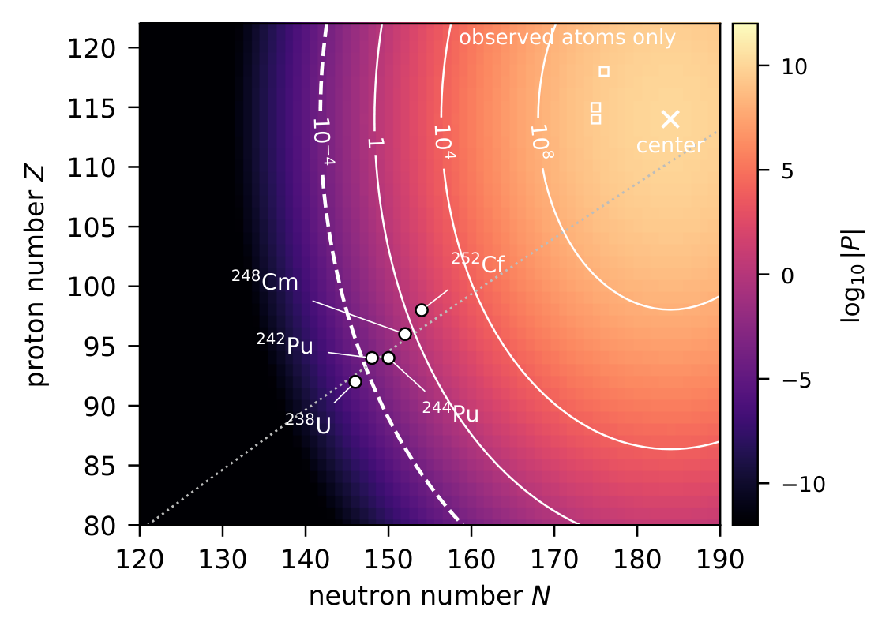
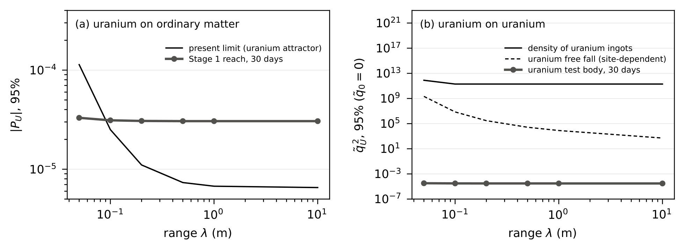
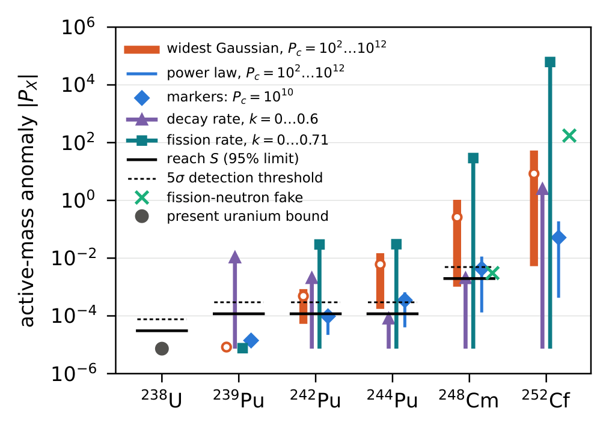
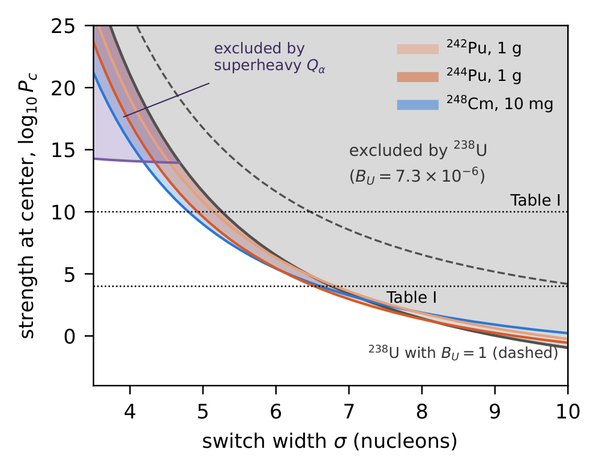
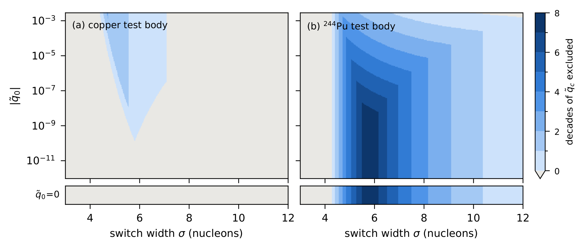
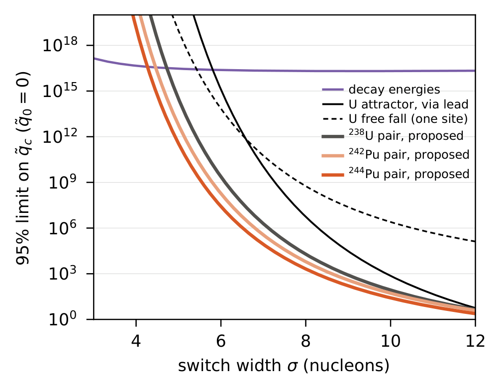

# Code and data: Active-mass tests with transuranic sources

Justin Grady, Variable Systems (justin@variable-systems.com)

Companion archive to *Active-mass tests with transuranic sources: a blind spot for composition-dependent
forces* (DOI: [10.5281/zenodo.24410571](https://doi.org/10.5281/zenodo.24410571); the paper is
[`paper/Grady_2026_active_mass_transuranic.pdf`](paper/Grady_2026_active_mass_transuranic.pdf)). Every number,
table and figure in the paper is generated by the scripts here.

Every laboratory test of the universality of gravity has used matter no heavier than uranium, so a force tied to
nuclear structure that is negligible up to uranium but grows toward the island of stability would have escaped all
of them. The paper bounds what existing data still allow, then simulates torsion-balance comparisons of plutonium
and curium sources against mass-matched dummies, starting with depleted uranium against tungsten.

<p align="center"></p>

**Fig. 1.** The broadest Gaussian switch the present uranium bound allows (B<sub>U</sub> = 7.3×10<sup>−6</sup>,
P<sub>c</sub> = 10<sup>10</sup>), as log<sub>10</sub>|P| over the chart of nuclides. Dashed contour: the
10<sup>−4</sup> reach of the proposed measurement. Circles: heavy nuclides available in weighable quantity; squares:
superheavy nuclides observed only atom by atom. Dotted: the line of β stability.

## Quick start

```
pip install -r requirements.txt
python run_all.py           # about 5 s: rebuilds the paper's numbers, tables and figures from the shipped results
python run_all.py --full    # reruns every simulation and fit first (about 11 minutes on a laptop CPU), then the above
python run_all.py --mass-models   # reruns only the mass-model check of Sec. II D (about 2 minutes)
python run_all.py --check   # compares the current outputs with the shipped ones, runs nothing
```

`run_all.py` copies the shipped outputs to `_shipped/` before it runs anything. Afterward it compares every
regenerated JSON file with its shipped copy, number by number, and the tables and CSV as text, then prints
`all outputs reproduce` or lists the differences. Every random draw is seeded. The shipped results were made
partly on Linux and partly on Windows; a full rerun on Windows (Python 3.12, the versions in `requirements.txt`) gave identical tables, identical
fits, and simulation outputs that agree to 5e-6 relative or better (floating-point differences between
platforms). No number printed in the paper changes.

`--full` and `--mass-models` first run `data/fetch_data.py`, which downloads the input tables that are not
shipped (see Data below) and checks every table against its SHA-256 hash. If a table for the mass-model check
cannot be fetched, that one step is skipped and its shipped result is used; nothing else depends on it.

## What makes what

| Paper | Made by | Output |
|---|---|---|
| Sec. II-III, Table I (predictions), Fig. 1 (nuclide chart) | `paper/compute.py` | `paper/tab_predictions.tex`, `paper/figs/fig1_chart.pdf` |
| Sec. II D (superheavy alpha-decay fit, independent errors) | `2_indirect_search/data_test.py` (with `channels.py`) | `data_test.json`, `residuals_she.csv` |
| Sec. II D (correlated-residual fit used for the bound) | `2_indirect_search/data_test_robust.py` | `data_test_robust.json` |
| Sec. II D (the same fit against WS4, FRDM(2012) and KTUY05) | `residual_analyzer/ra_ingest.py`, then `residual_analyzer/residual_analyzer.py` | `residual_analyzer/out/results.json` (and `REPORT.md`, a wider search of the same residuals that is not used in the paper) |
| Sec. IV time-domain simulation of the torsion balance | `1_experiment_sim/active_mass_sim.py` | `results.json` |
| Sec. IV systematic budget, injection-recovery | `1_experiment_sim/detection_map.py` | `detection_results.json` |
| Sec. IV depleted-uranium stage, per-gram magnetic spec | `1_experiment_sim/u_stage_refine.py` | `u_stage_refine.json` |
| Sec. IV noise calibration (520 independent 90-day records) | `1_experiment_sim/calibration_check.py` | `calibration_check.json` |
| Sec. IV comparison with published balances | `1_experiment_sim/instrument_calibration.py` | `instrument_calibration.json` |
| Sec. II E and Table V (a heavy source on a test body of its own nuclide) | `paper/compute.py` | `paper/tab_heavy.tex` |
| Sec. IV D: every campaign rerun with a test body of the source's own nuclide | `heavy_pair/heavy_pair_sim.py 2000` (about 26 minutes on 10 cores; not run by `run_all.py`) | `heavy_pair/out/heavy_pair_sim.json` |
| Sec. IV C-D: Stage 1 with a uranium test body, 5 cm to 10 m, 30 and 90 days, and its error budget | `heavy_pair/u238_pair_campaign.py 1000` (about 20 minutes; not run by `run_all.py`) | `heavy_pair/out/u238_pair_campaign.json`, `.md` |
| Sec. II A (linearity, no screening), Sec. V B (the uranium-pair window): an adversarial check of the model against equivalence-principle tests, source self-screening, a 3D torque quadrature and the weak-field action | `validation/physics_audit.py` (about 7 minutes; not run by `run_all.py`) | `validation/out/audit_results.json`, `AUDIT_SUMMARY.md` |
| Sec. IV D: the Newtonian residual against capsule tolerance (the paper's Monte Carlo at 1-10 um) | `validation/tolerance_scan.py` (about 2 minutes; not run by `run_all.py`) | `validation/out/tolerance_scan.json` |
| Sec. III C-D: the largest powers of the decay-rate and fission-rate benchmarks that the measured masses allow (every AME2020 mass and Q_alpha against the NUBASE2020 half-lives and branches) | `validation/decay_rate_bound.py` (under a second; needs NUBASE2020 from `data/fetch_data.py` and the mass-model check's `residual_analyzer/cache/experiment.json`; not run by `run_all.py`) | `validation/out/decay_rate_bound.json`, which `paper/compute.py` reads |
| Sec. III D: charges that follow shell closure (shell correction, shell gaps, valence product, shell share of the fission barrier) in four mass models, against uranium's and lead's own limits, at 2 cm to 0.5 m | `validation/shell_closure_scan.py` (about 30 seconds; needs the WS4, KTUY05 and FRDM2012 tables from `data/fetch_data.py` and the mass-model check's caches; not run by `run_all.py`) | `validation/out/shell_closure_scan.json` (read by `paper/compute.py`), `.md` |
| Tables II-IV, Figs. 2-6, every number quoted in the text | `paper/compute.py` | `paper/numbers.json`, `tab_practical.tex`, `tab_campaign.tex`, `tab_fingerprint.tex`, `figs/fig_uranium_pair.pdf`, `figs/fig2_predictions.pdf`, `figs/fig3_reach.pdf`, `figs/fig_blind_spot.pdf`, `figs/fig_heavy_limits.pdf` |

Order matters in a full run: `active_mass_sim.py`, then `detection_map.py`, `u_stage_refine.py`,
`calibration_check.py`, `instrument_calibration.py`; then `channels.py`, `data_test.py`, `data_test_robust.py`;
then the mass-model check; then `paper/compute.py`. `run_all.py --full`
does this.

`paper/main.tex` is the paper's source. It compiles with the tables and `figs/` beside it (REVTeX 4.2; the
author used tectonic).

## Figures

The figures of the paper, as PNG copies for this page. The paper uses the PDFs in `paper/figs/`, made by
`paper/compute.py`; Fig. 1 is above.

<p align="center"></p>

**Fig. 2.** Stage 1 by range, from the time-domain simulation. (a) Uranium on ordinary matter: the present limit
and the reach of a 30-day run with a copper test body. (b) Uranium on uranium, with ordinary matter uncharged: the
limits from the normal density of large uranium ingots and from uranium's free fall, and the reach with a uranium
test body.

<p align="center"></p>

**Fig. 3.** Predicted anomaly |P<sub>X</sub>| for each candidate source at the present uranium bound, for central
strengths P<sub>c</sub> = 10<sup>2</sup> to 10<sup>12</sup>: orange, the broadest Gaussian switch; blue, the power
law; purple, the decay-rate benchmark (k up to 0.6); teal, the fission-rate benchmark (k up to 0.71). Solid ticks:
the reach S; dashed ticks: the five-standard-deviation threshold; crosses: the anomaly faked by fission-neutron
momentum.

<p align="center"></p>

**Fig. 4.** Reach in the parameter space of the Gaussian switch. Gray: excluded by the present uranium bound
(dashed: where that boundary would lie if uranium's anomaly were allowed up to 1). Purple: excluded by superheavy
alpha-decay energies. Orange and blue bands: what a null result at the proposed reach would exclude.

<p align="center"></p>

**Fig. 5.** What a null result with <sup>244</sup>Pu (90 days) would add for the Gaussian switch centered on
(Z, N) = (114, 184) at a range of 0.5 m: the decades of the central charge it would exclude below the present limit,
against the switch width and ordinary matter's charge; gray, none. (a) Copper test body. (b) <sup>244</sup>Pu test
body, for the worse relative sign of the charges.

<p align="center"></p>

**Fig. 6.** Limits on the central charge if ordinary matter carries no charge. Existing: superheavy alpha-decay
energies (purple), the uranium-attractor test through lead's own charge (black), and uranium's free fall with one
part per million of uranium in the ground (dashed). Proposed: null results with each source on a test body of its
own nuclide.

## Data

- `data/rct1.mas20`, `data/mass.mas20`: AME2020 reaction-energy table 1 and mass table, from the Atomic Mass
  Data Center. M. Wang et al., Chin. Phys. C 45, 030003 (2021). Shipped unmodified so the fits can be rerun.
- `data/WS_mass_table.txt` (not shipped): the Weizsacker-Skyrme-type mass model of N.-N. Ma et al.,
  Chin. Phys. C 43, 044105 (2019), as published at https://github.com/lukeronger/NuclearData-LZU. That
  repository states no license, so `data/fetch_data.py` downloads it and checks that it is the same file the
  paper used.
- For the mass-model check only (not shipped, fetched into `residual_analyzer/raw/`): WS4 (N. Wang et al.,
  Phys. Lett. B 734, 215 (2014), imqmd.com/mass), HFB-24 (S. Goriely et al., Phys. Rev. C 88, 024308 (2013),
  BRUSLIB), KTUY05 (H. Koura et al., Prog. Theor. Phys. 113, 305 (2005), JAEA), and FRDM(2012) (P. Moller et al.,
  At. Data Nucl. Data Tables 109-110, 1 (2016)), whose table is the text of arXiv:1508.06294v1 extracted with
  `pdftotext -raw -enc UTF-8`. Hashes of the files used are in `residual_analyzer/cache/SOURCES.json`.
- Photon data for the gamma-ray push of Sec. IV C, written into `paper/compute.py` with their sources: the mass
  attenuation coefficients of copper and tungsten (J. H. Hubbell and S. M. Seltzer, NIST Standard Reference
  Database 126) and the gamma- and X-ray lines of Am-241, Cf-249 and Cf-251 (ENSDF, retrieved through the IAEA
  LiveChart of Nuclides).

## Changes from the working copies

The scripts are the ones that produced the paper, with three edits that do not change any result:
`paper/compute.py` reads from this folder layout; `2_indirect_search/data_test.py` reads its input tables from
`data/` instead of absolute paths; `1_experiment_sim/active_mass_sim.py` aliases `numpy.trapezoid` to
`numpy.trapz` on numpy older than 2.0.

## License

Code (`*.py`): MIT, see `LICENSE`. Paper source, tables and figures: CC BY 4.0. Input data: the terms of their
publishers, as above.

## Citation

J. Grady, Active-mass tests with transuranic sources: a blind spot for composition-dependent forces,
Zenodo (2026), doi:10.5281/zenodo.24410571.
